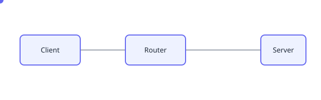

This post demonstrates embedding motion in a Hugo post. Delete it once you've tried it.

## Animated packet flow (SVG)

The diagram below is a plain animated SVG stored in this post's `images/` folder.
It works with normal Markdown — no shortcode, no JavaScript:



## Video (optional)

For longer animations, render a WebM/MP4 and use the `video` shortcode:

```text

```

The shortcode looks for the file in the post bundle and renders a looping,
muted, autoplaying `<video>`. Replace `packet-flow.webm` with your own file.
