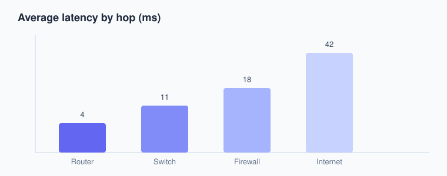

This is a **sample post** demonstrating the kinds of content you can write: prose, shell commands, images, diagrams, tables, and callouts. Delete it once you get the hang of things.

## The topology

The diagram below is a page-bundle image (`topology.svg`) that lives next to this `index.md` inside the post folder.



## Commands you'll use

Check how a host reaches the router:

```bash
ping -c 4 192.168.0.1
```

Trace the path to a public address:

```bash
traceroute 1.1.1.1
```

Inspect the local interface configuration:

```bash
ip addr show
```

> Tip: on macOS use `ifconfig` and `traceroute`; on Windows use `ipconfig` and `tracert`.

## Measuring latency per hop

This second image (`latency-chart.svg`) shows average latency added at each device:



| Device   | Role            | Avg latency |
| -------- | --------------- | ----------- |
| Router   | Gateway         | 4 ms        |
| Switch   | L2 forwarding   | 11 ms       |
| Firewall | Filtering       | 18 ms       |
| Internet | Uplink          | 42 ms       |

## Where files live

For this post the folder looks like:

```text
content/posts/network-basics/
├── index.md
├── topology.svg
└── latency-chart.svg
```

Reference bundled images by their **filename only** (no path), and shared images with a leading slash, e.g. `/images/logo.png`.

## Wrap up

That's the whole workflow: write Markdown, drop images in the bundle, preview with `hugo server -D`, then `git push`.
